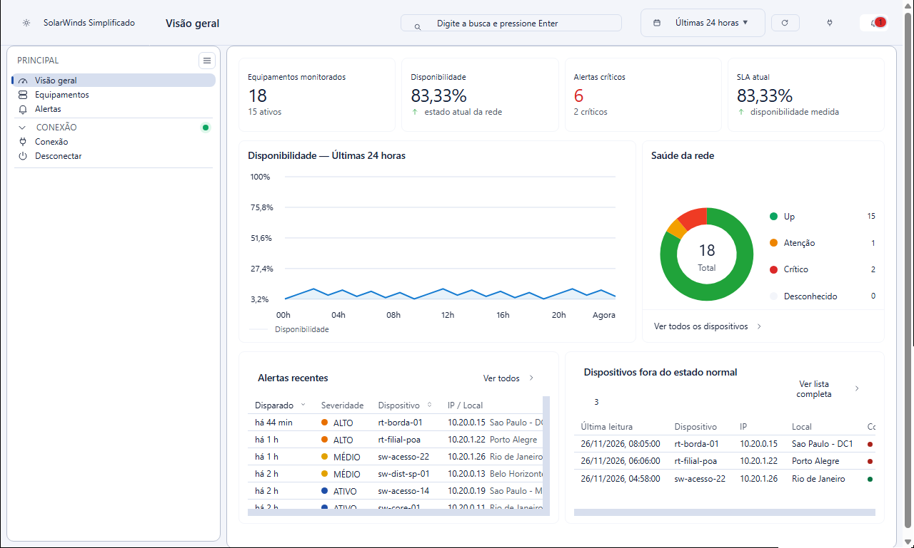
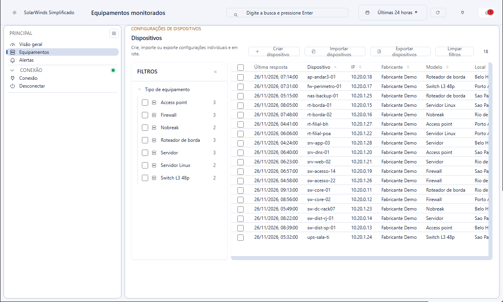
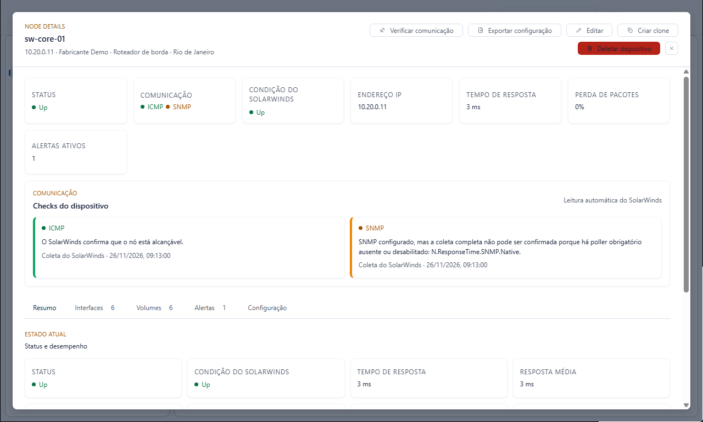
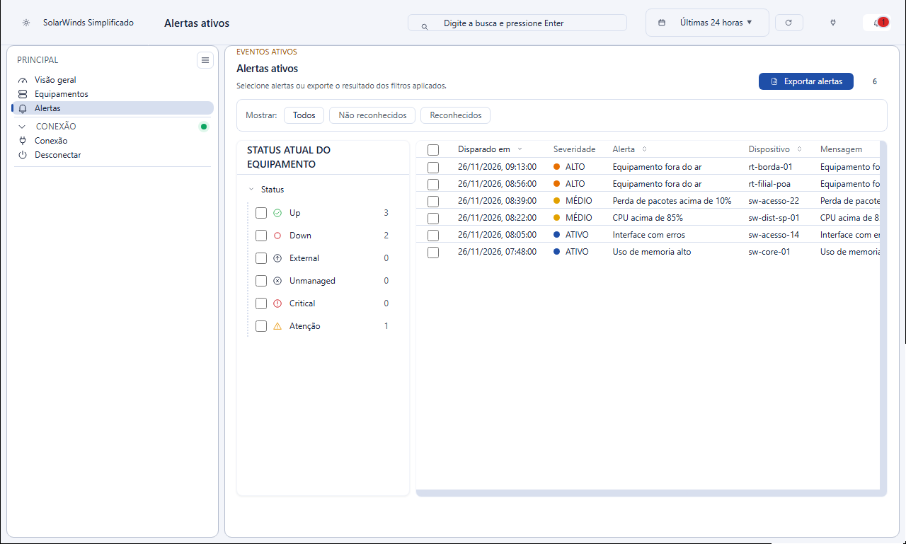
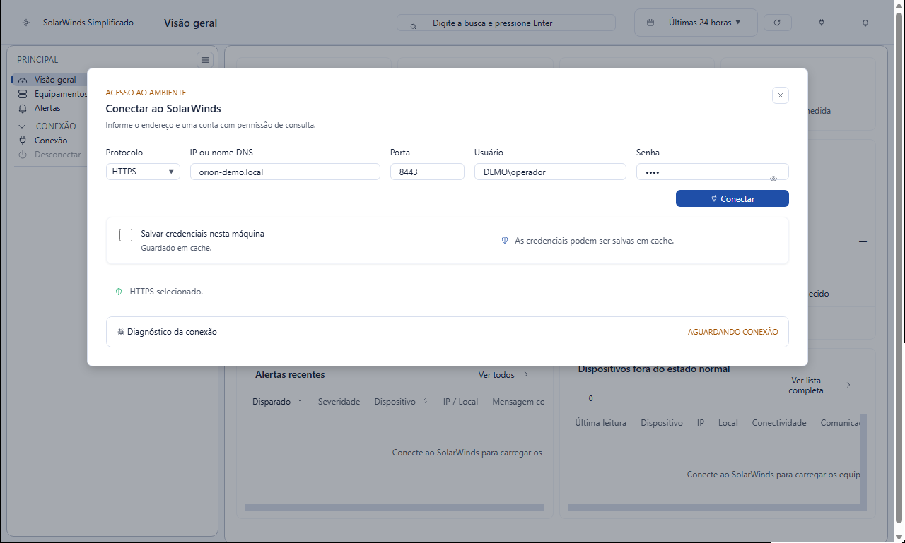

# SolarWinds-releases

**PT** — Distribuição oficial do SolarWinds Simplificado para Windows: pacote portátil (.zip) e instalador (.msi), com as notas de cada versão. Baixe na aba [Releases](https://github.com/Dorflex-DD/SolarWinds-releases/releases). Este repositório não contém código-fonte. Os mesmos pacotes estão no GitLab: https://gitlab.com/fabioffg/solarwinds-simplificado/-/releases

**EN** — Official Windows distribution of SolarWinds Simplificado: portable package (.zip) and installer (.msi), with release notes. Download from the [Releases](https://github.com/Dorflex-DD/SolarWinds-releases/releases) tab. This repository holds no source code. The same packages are on GitLab: https://gitlab.com/fabioffg/solarwinds-simplificado/-/releases

## Telas / Screens (v147.13)

Imagens da versão publicada, com dados fictícios. / Screenshots of the published release, with sample data.

**Visão geral** — equipamentos, disponibilidade e alertas recentes num só painel.
*Overview — devices, availability and recent alerts in one dashboard.*

**Equipamentos** — lista com filtros; crie, importe ou exporte dispositivos.
*Devices — filterable list; create, import or export devices.*

**Detalhe do equipamento** — status, comunicação ICMP/SNMP, editar, clonar e apagar.
*Device details — status, ICMP/SNMP checks, edit, clone and delete.*

**Alertas ativos** — severidade, filtros e exportação.
*Active alerts — severity, filters and export.*

**Conexão** — endereço, porta e conta de consulta.
*Connection — address, port and read-only account.*

