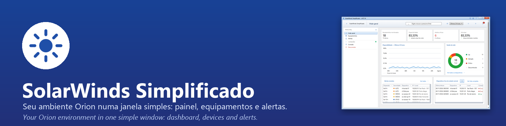
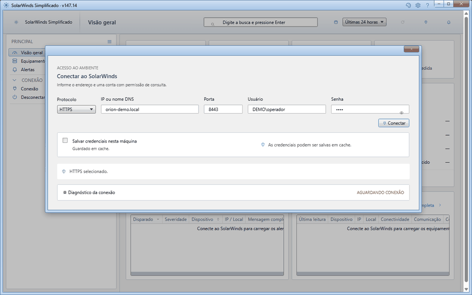
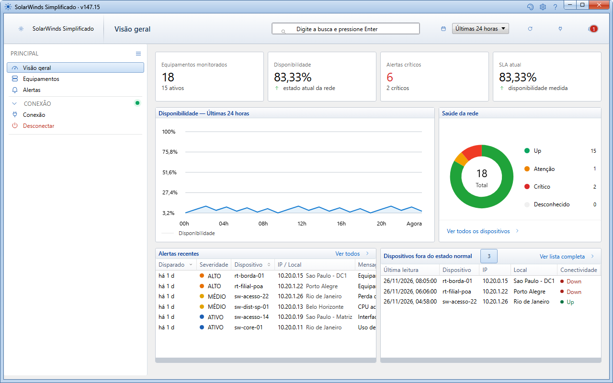
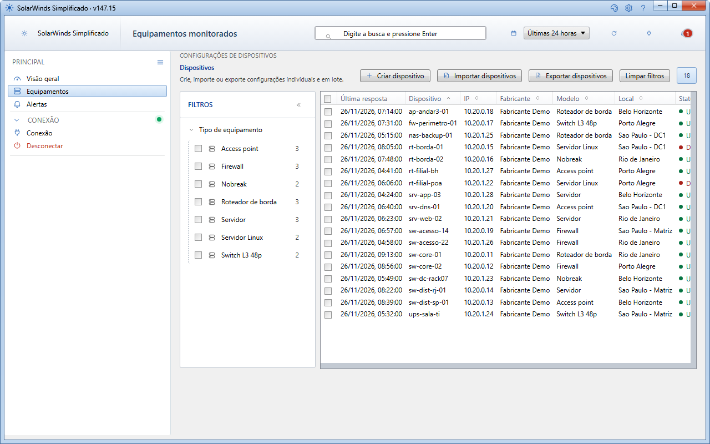
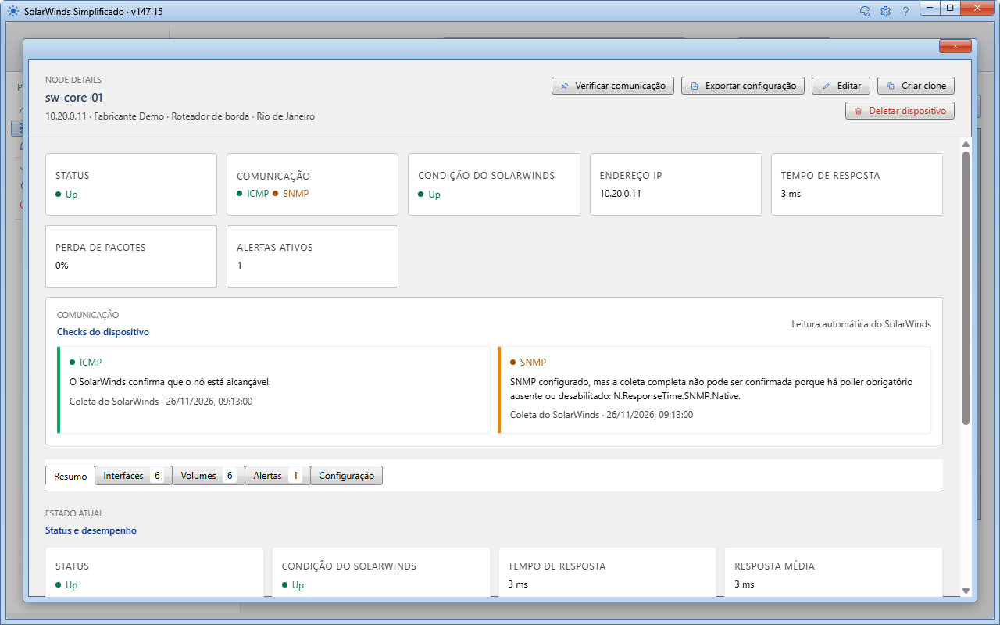
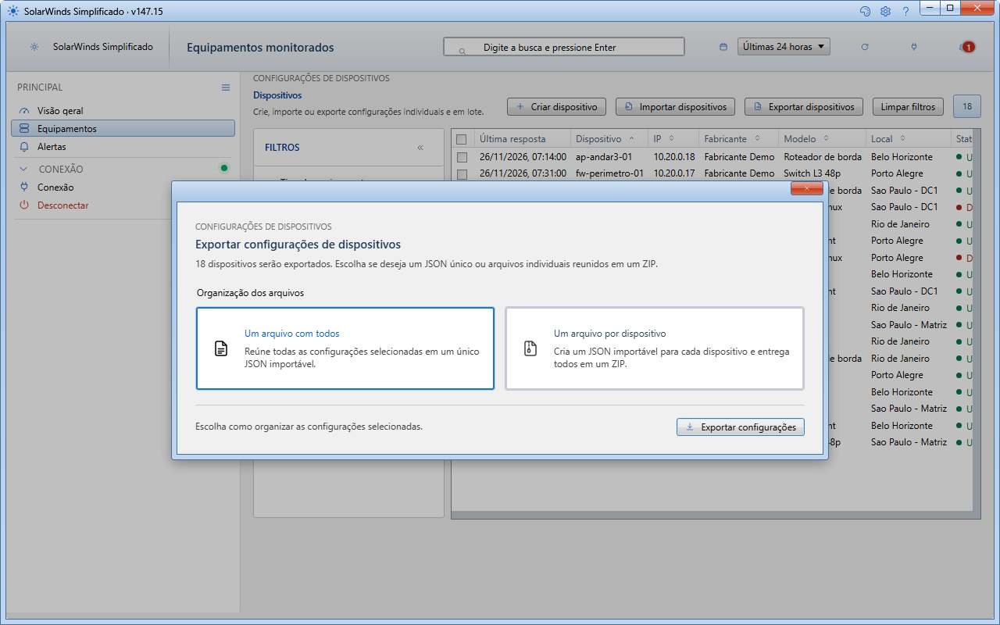
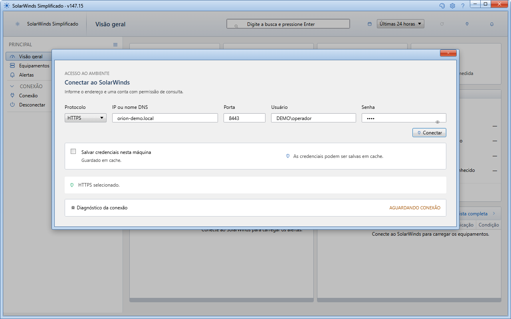
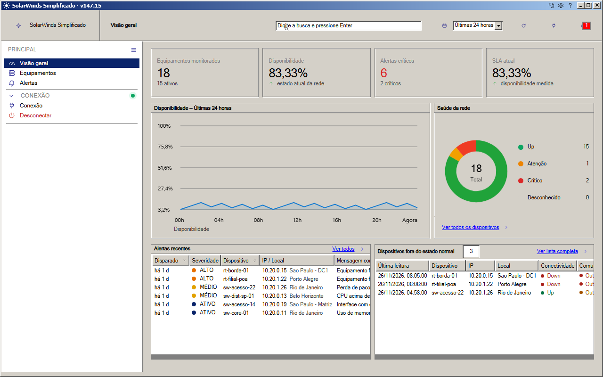
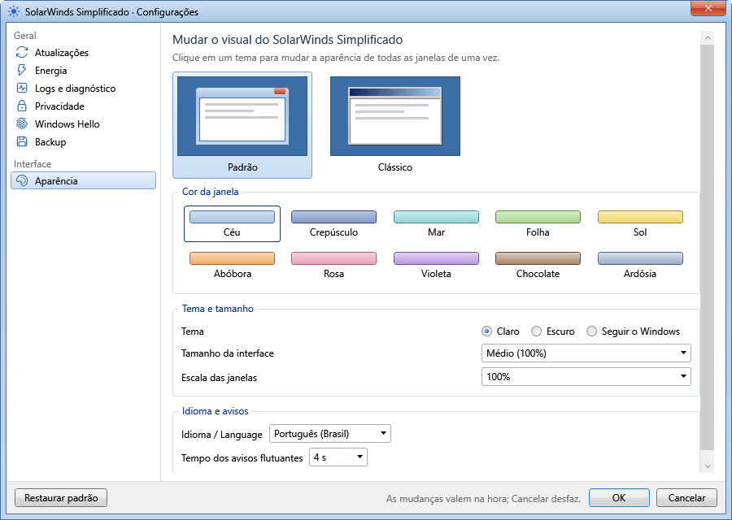
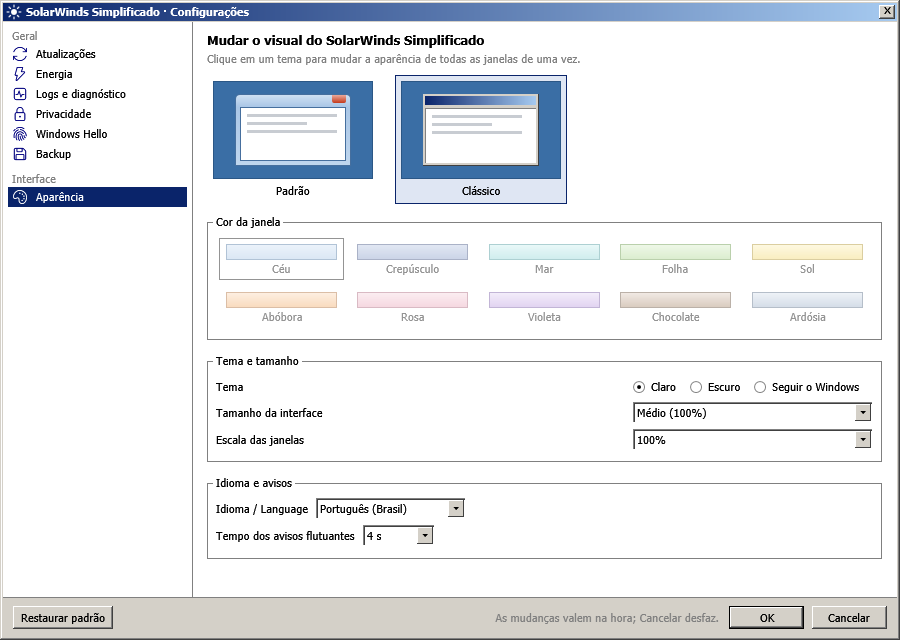

   

<b>O dia a dia do SolarWinds Orion numa janela simples e rápida.</b> <i>Everyday SolarWinds Orion work in one simple, fast window.</i>

## O que é / What it is
Um cliente para quem administra o SolarWinds Orion e quer ver o estado da rede e cuidar dos equipamentos sem passar pelas telas pesadas do console web. Mostra painel, equipamentos e alertas, e cria, edita, clona, importa e exporta dispositivos.
*A client for SolarWinds Orion administrators who want to see network health and manage devices without the heavy web console screens. It shows a dashboard, devices and alerts, and creates, edits, clones, imports and exports devices.*

## Destaques / Highlights
| | |
|---|---|
| **Painel da rede** — equipamentos, disponibilidade, saúde e alertas recentes numa olhada. *Network dashboard — devices, availability, health and recent alerts at a glance.* |  |
| **Equipamentos sob controle** — lista com busca e filtros; criar, importar e exportar em lote. *Devices under control — searchable, filterable list; create, import and export in bulk.* |  |
| **Detalhe completo** — status, teste ICMP/SNMP, editar, clonar e excluir num só lugar. *Full details — status, ICMP/SNMP test, edit, clone and delete in one place.* |  |

## Como funciona / How it works
1. Instale (.msi, sem administrador) ou abra o portátil (.zip). / *Install the .msi (no admin) or open the portable .zip.*
2. Informe o endereço do Orion e uma conta com permissão de consulta. / *Enter the Orion address and an account with read permission.*
3. Pronto: painel, equipamentos e alertas aparecem na hora, pela API oficial (SWIS). / *Done: dashboard, devices and alerts show up right away, through the official API (SWIS).*

## Funcionalidades / Features
| Recurso / Feature | O que faz / What it does |
|---|---|
| Visão geral / Overview | Disponibilidade, saúde da rede e alertas no período escolhido. / *Availability, network health and alerts for the chosen period.* |
| Equipamentos / Devices | Busca, filtros, detalhe, interfaces, discos e histórico de alertas. / *Search, filters, details, interfaces, disks and alert history.* |
| Cadastro / Provisioning | Criar, importar (várias cópias), editar, clonar e excluir. / *Create, import (many copies), edit, clone and delete.* |
| Exportar / Export | CSV (Excel), PDF, JSON ou Markdown; configuração para importar depois. / *CSV (Excel), PDF, JSON or Markdown; device config to import later.* |
| Alertas / Alerts | Alertas ativos com severidade, filtros e exportação. / *Active alerts with severity, filters and export.* |
| Aparência / Appearance | Tema Padrão (10 cores) ou Clássico, escolhidos em Configurações. / *Standard theme (10 colors) or Classic, chosen in Settings.* |
| Segurança / Security | Senha protegida pelo Windows (DPAPI); atualização assinada e automática. / *Password protected by Windows (DPAPI); signed automatic updates.* |

## Galeria / Gallery
| | |
|---|---|
|  Alertas ativos / *Active alerts* |  Exportar configurações / *Export configurations* |
|  Conectar ao Orion / *Connect to Orion* |  Tema Clássico / *Classic theme* |
|  Configurações › Aparência / *Settings › Appearance* |  Configurações no Clássico / *Settings in Classic* |

Imagens com dados fictícios. / *Screenshots with sample data.*

## Baixar / Download
- [Instalador / Installer (.msi) — versão mais nova / latest](https://github.com/Dorflex-DD/SolarWinds-releases/releases/latest)
- [Portátil / Portable (.zip) — versão mais nova / latest](https://github.com/Dorflex-DD/SolarWinds-releases/releases/latest)

Windows 10/11 x64 · .NET 10 Desktop Runtime · WebView2 Runtime

## Novidades / What's new — v147.15
- Temas com nomes novos, Padrão e Clássico; títulos dos grupos em azul-escuro e ícones sempre azuis (a cor da janela vale só na moldura). / *Themes renamed Standard and Classic; dark-blue group titles and always-blue icons (the window color only affects the frame).*
- Configurações com lista e página encostadas, rodapé com "Restaurar padrão" e caixas de escolha brancas. / *Settings with flush list and page, a "Restore defaults" footer and white drop-downs.*
- Filtros dos alertas na caixa "Mostrar", listas mais baixas e aviso de versão nova no formato das mensagens. / *Alert filters in a "Show" box, shorter list rows and the new-version notice as a message.*
- Tamanho da interface em todas as janelas; no Clássico, nenhum canto arredondado e letra Tahoma. / *Interface size in every window; no rounded corners and Tahoma in Classic.*

Uso somente com autorização escrita do autor. Termos em [LICENSE](https://github.com/Dorflex-DD/SolarWinds-releases/releases/latest/download/LICENSE). / Use only with the author's written authorization. Terms in [LICENSE](https://github.com/Dorflex-DD/SolarWinds-releases/releases/latest/download/LICENSE).
